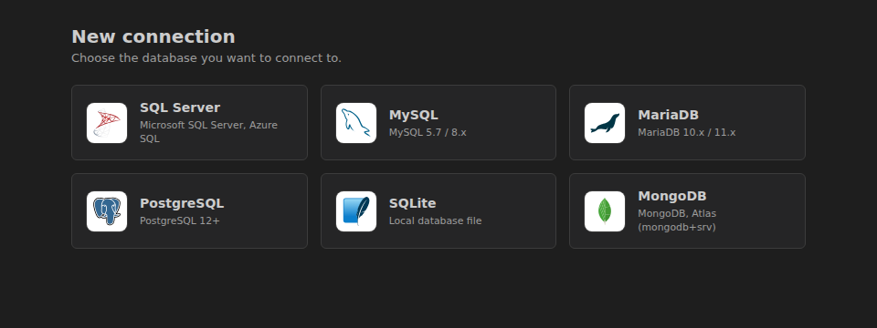
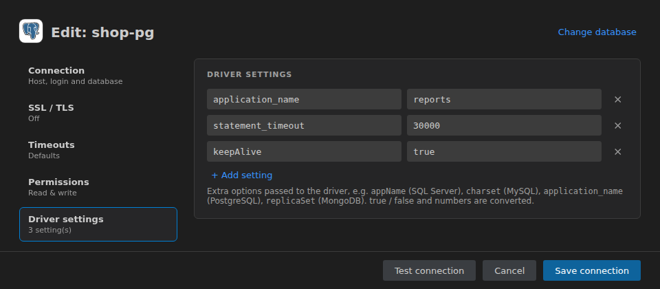
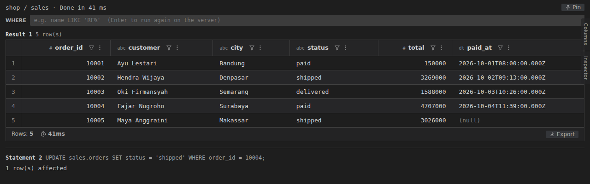
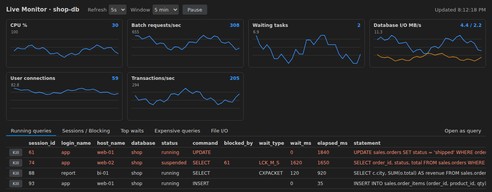

# Moonage Daydream

[English](README.md) | Bahasa Indonesia

Database client untuk VS Code: SQL Server, MySQL / MariaDB, PostgreSQL, SQLite dan MongoDB, plus Consul (KV store dan dashboard cluster). Tulis query di file `.sql`, jalankan dengan shortcut atau CodeLens, lalu lihat, filter, edit dan export hasilnya di grid.


## Fitur

- **Enam jenis koneksi**:
  - **SQL Server**: SQL login atau Windows authentication (NTLM dengan domain), named instance lewat SQL Server Browser, SSL / TLS (encrypt) dengan opsi *trust server certificate*, pemisah batch `GO`.
  - **MySQL / MariaDB** (mysql2) dan **PostgreSQL** (pg).
  - **SQLite** (sql.js, WebAssembly): file database dibaca setiap query dan ditulis balik setelah statement yang mengubah data.
  - **MongoDB**: query gaya mongosh seperti `db.users.find({ age: { $gt: 30 } }).sort({ name: 1 }).limit(10);`, plus `aggregate`, `countDocuments`, `distinct`, insert / update / delete, `db.getCollection(...)` dan `db.runCommand(...)`. Dokumen ditampilkan sebagai kolom grid. Host boleh berupa connection string `mongodb://` atau `mongodb+srv://`.
  - **Consul** (HTTP API): telusuri dan edit key KV (JSON / YAML / teks) dengan backup sebelum setiap perubahan, dan dashboard untuk leader, node, service dan health check. ACL token disimpan di SecretStorage VS Code.
- **View Connections**: koneksi → database → Tables / Views / Procedures → kolom, dengan logo per jenis database. **Select Top 100** pada table atau view, **New SQL File** pada database. Password disimpan di SecretStorage VS Code.
- **Connect / Disconnect** per koneksi, dengan status `● connected` di **Connections**; Disconnect menanyakan commit atau rollback transaksi manual yang masih terbuka dulu. Opsional auto disconnect koneksi yang idle.
- **View, procedure dan function** (SQL Server, MySQL / MariaDB, PostgreSQL): klik kanan untuk **Show Definition**, **Edit** (script `CREATE OR ALTER` / `CREATE OR REPLACE`) dan **Run Procedure…** (script EXEC / CALL / SELECT dengan semua argumen); procedure dan function bisa di-expand ke parameternya.
- **SQL Server Object Explorer** seperti ekstensi mssql: Databases / System Databases, Security, Server Objects, SQL Server Agent (job dengan **Start Job** / **Stop Job**); per database Tables, Views, Synonyms, Programmability dan Security; per table Columns, Keys, Constraints, Triggers, Indexes dan Statistics. **Script as…** CREATE / ALTER / DROP / SELECT / INSERT / UPDATE / DELETE, **Activity Monitor**, **Kill Session…**, **Server Info**, **Database Info**, **Backup / Restore Database (script)…**.
- **Live Monitor (charts)** untuk SQL Server, MySQL / MariaDB dan PostgreSQL: grafik live untuk seluruh server atau satu database, dengan tab Running queries, Sessions / Blocking, waits dan Expensive queries, serta **Kill** dengan konfirmasi.
- **Form koneksi** dengan sidebar: **Connection**, **SSL / TLS**, **Timeouts**, **Permissions** (read only) dan **Driver settings**, masing-masing dengan ringkasan singkat. **Import connection string** mengisi form dari string SQL Server `Server=...;Database=...` atau URL `mysql://`, `mariadb://`, `postgres://` atau `mongodb://`.
- **Import Connections from DBCode…**: menyalin koneksi dari setting DBCode `dbcode.connections` (tanpa password).
- **Group dan warna koneksi**: kelompokkan koneksi ke folder group (mis. `prod`, `non-prod`) dan beri warna; koneksi berwarna juga ditandai di editor `.sql`, membantu mengenali koneksi production.
- **Koneksi dan database per file**, tampil dan bisa diganti lewat CodeLens.
- **Run**: selection, atau statement di posisi kursor. CodeLens di atas setiap statement: **Execute**, **Explain**, **Analyze** (hanya SELECT), koneksi, database dan mode transaksi. Beberapa SELECT yang dipilih bersamaan berjalan paralel. Query yang sedang berjalan bisa di-cancel di server.
- **Auto limit** untuk satu SELECT, lalu **Load more (+1000)** sampai 50.000 baris di grid.
- **Mode transaksi manual** per file dengan lens **Commit** / **Rollback**; di SQL Server, MySQL / MariaDB dan PostgreSQL statusnya dibaca dari server dan `COMMIT` / `ROLLBACK` boleh ada di dalam script.
- **Konfirmasi Auto-commit**: statement yang mengubah data di mode Auto-commit minta konfirmasi dulu (aktif secara default; bisa dimatikan per group atau koneksi).
- **Grid hasil**: tag tipe kolom, toolbar WHERE yang menjalankan ulang query di server, filter / sort / hide per kolom pada baris yang sudah dimuat, urutan kolom bisa diubah, panel samping **Columns** / **Inspector**, pilih baris lalu Ctrl+C (tersalin sebagai TSV), virtual scroll untuk hasil besar. Hasil UPDATE / INSERT / DELETE menampilkan `n row(s) affected` di bawah judul **Statement n**, juga di samping hasil SELECT.
- **Export** semua data atau baris terpilih ke CSV, TSV, JSON, JSON (pretty), Markdown, HTML atau Excel (.xlsx), atau salin ke clipboard.
- **Pin results** supaya hasil tetap di tab sendiri, berdampingan.
- **Edit cell**: perubahan menghasilkan script UPDATE berdasarkan primary key di tab baru. Script tidak pernah dijalankan otomatis.
- **Execution plan**: plan grafis dengan bar cost untuk SQL Server; output `EXPLAIN` sebagai grid untuk database lain.
- **Dukungan editor**: autocomplete (database, schema, table, kolom termasuk alias dan tabel target UPDATE / INSERT / DELETE, keyword dan function; untuk MongoDB collection, method, nama field dan operator `$`), formatter (dialect mengikuti koneksi), lint untuk statement tanpa `;` dengan Quick Fix.
- **View samping**: **SQL Files** (folder atau daftar rata, dengan rename, duplicate, delete dan drag & drop), **Running Queries**, **Query History**.

## Instalasi

Dari source:

```bash
npm install
npm run install:local   # build VSIX lalu install bila versinya berubah (tambah -- --force untuk install ulang)
```

Lalu jalankan **Developer: Reload Window**.

Atau build paketnya dan install manual:

```bash
npm run package
code --install-extension moonage-daydream-<version>.vsix
```

## Cara pakai

### 1. Tambah koneksi

Buka view **Moonage Daydream** di Activity Bar lalu klik **+** (**Add Connection**) di view **Connections**. Koneksi baru dibuat dalam dua langkah:

1. **Pilih database**: di bawah header **New connection**, kartu berwarna khas tiap database, dengan logo, untuk SQL Server, MySQL, MariaDB, PostgreSQL, SQLite, MongoDB dan Consul. Kartu muncul dengan animasi singkat dan menampilkan **Connect →** saat di-hover (gerakan dikurangi bila OS meminta reduced motion). Kartu itu mengisi port default dan contoh username untuk tipe tersebut.
2. **Isi form** untuk tipe itu. **Change database** (kanan atas) kembali ke langkah 1.

**Search databases** (kanan atas langkah 1) menyaring kartu.



Form punya sidebar di kiri; tiap item membuka bagiannya sendiri dan menampilkan ringkasan singkat pengaturannya (mis. *Off*, *Defaults*, *Read & write*, *3 setting(s)*):

- **Connection**:
  - **Connection**: nama, **Group** dan **Color** (lihat di bawah);
  - **Server**: host dan port; untuk SQL Server juga instance name (port lalu ditentukan oleh SQL Server Browser). Untuk MongoDB host boleh berupa connection string lengkap `mongodb://` atau `mongodb+srv://`. Untuk SQLite kartu ini hanya berisi path file database;
  - **Authentication**: username dan password (ikon mata menampilkan atau menyembunyikannya); untuk SQL Server metode *SQL login* atau *Windows (NTLM)* dengan domain; untuk MongoDB auth database;
  - **Database**: database default (opsional).
- **SSL / TLS**: **Enable SSL / TLS** (default aktif untuk SQL Server, di sana disebut *encrypt*; mati untuk database lain) dan **Trust server certificate** (untuk sertifikat lokal atau self-signed; mati = sertifikat diverifikasi), untuk semua driver.
- **Timeouts**: **Connection timeout** dalam detik (default 15). Query yang sedang berjalan tidak punya timeout (juga di SQL Server); hentikan dengan **Cancel**.
- **Permissions**: **Read only**. Hanya statement yang tidak mengubah data yang boleh dijalankan (SELECT / WITH, DECLARE, `SET @var`, SHOW, DESCRIBE; untuk MongoDB method baca). UPDATE, INSERT, DELETE, MERGE, `SELECT ... INTO`, DDL dan EXEC diblokir sebelum ada yang dikirim ke server, dan panel hasil menampilkan statement yang diblokir.
- **Driver settings**: opsi key / value tambahan yang diteruskan ke driver, mis. `appName` (SQL Server), `charset` (MySQL), `application_name` (PostgreSQL), `replicaSet` (MongoDB). Nilai `true` / `false` dan angka dikonversi; **+ Add setting** menambah baris, **×** menghapusnya.

**Import connection string** (di kartu **Server**) membuka kotak untuk menempel connection string; **Fill the form** mengisi host, port, user, password, database, SSL dan opsi, dan mengganti tipe database bila perlu. Tidak ada yang disimpan sebelum **Save connection**. Yang didukung:

- SQL Server (ADO.NET): `Server=host,1433;Database=shop;User ID=app;Password=...;Encrypt=true;TrustServerCertificate=true`; juga `Data Source` / `Initial Catalog`, `host\instance`, dan `Integrated Security=SSPI` (Windows authentication);
- URL: `mysql://`, `mariadb://`, `postgres://` / `postgresql://`, `mongodb://` dan `mongodb+srv://`, mis. `postgres://app@db.example.com:5432/shop?sslmode=require&application_name=reports`. `ssl`, `tls` dan `sslmode` mengatur SSL / TLS, `authSource` mengatur auth database MongoDB, dan opsi query lainnya masuk ke **Driver settings**.




Untuk **Consul** form berisi host dan port (default 8500), **Enable SSL / TLS** untuk HTTPS, **ACL token** (di field password, disimpan di Secret Storage; kosong = tanpa token) dan **Datacenter** (di field database; kosong = datacenter milik agent). Tidak ada username. Lihat [Consul](#13-consul).

**Test connection** mengecek koneksi sebelum **Save connection** (untuk Consul menampilkan leader cluster); hasilnya tampil di footer di samping tombol. **Edit Connection** langsung membuka form (langkah 2).

**Import Connections from DBCode…** (menu **⋯** view **Connections**) membaca koneksi extension DBCode dari setting `dbcode.connections` dan menampilkannya di quick pick multi-pilih: nama, tipe, host, port, instance, user, database, group, SSL, connection timeout dan read only ikut disalin. Koneksi yang namanya sudah dipakai, atau tipenya tidak didukung, dilewati (pesannya menyebutkan daftarnya). Password tidak ikut diimport: password ditanya sekali saat koneksi pertama kali dipakai, lalu disimpan di Secret Storage VS Code.

**Group** menaruh koneksi di sebuah folder di **Connections**: pilih *No group*, group yang sudah ada, atau *New group…* untuk mengetik nama baru. Setiap folder group menampilkan jumlah koneksi di dalamnya; **+** (**Add Connection**) pada folder group langsung memilih group itu. Klik kanan folder group untuk **Rename Group…** dan **Auto-commit Confirmation…** (lihat [Transaksi](#7-transaksi)). Di quick pick koneksi, group ditampilkan sebagai `[group]`.

**Color** (swatch: None atau salah satu dari 15 warna: Red, Coral, Orange, Yellow, Gold, Lime, Green, Teal, Cyan, Sky, Blue, Purple, Magenta, Pink, Gray) menandai koneksi. Warnanya diambil dari tema VS Code (`charts.*` dan `terminal.ansi*`), jadi mengikuti tema terang maupun gelap:

- di **Connections** nama koneksi tampil dengan warna itu dan badge ●;
- di editor `.sql` yang terikat ke koneksi itu, ada bar berwarna di kiri semua baris, dan label `you are using connection <group> - <nama>` (tanpa group: `you are using connection <nama>`) tampil di akhir baris teratas yang terlihat, jadi tetap terlihat saat scroll.

Pakai misalnya Red untuk koneksi production.

Klik kanan koneksi di **Connections** untuk:

- **Select Connection**: jadikan koneksi aktif;
- **Connect** / **Disconnect**: lihat di bawah;
- **Edit Connection…** (juga tombol pensil di baris koneksi): buka form;
- **Rename…**: nama baru yang unik; password tersimpan dan file `.sql` yang terikat ke koneksi ikut pindah ke nama baru;
- **Change Color…**: quick pick dengan bulatan berwarna, atau *No color*;
- **Move to Group…**;
- **Auto-commit Confirmation…**: *On*, *Off* atau *Same as group* (lihat [Transaksi](#7-transaksi));
- **Live Monitor (charts)** (SQL Server, MySQL / MariaDB, PostgreSQL): lihat [Live Monitor](#12-live-monitor);
- **Delete Connection**: minta konfirmasi; password tersimpan ikut dihapus, dan file yang terikat kembali memakai koneksi aktif.

**Connect** membuka koneksi dan mengecek login (untuk Consul: membaca leader cluster); status bar menampilkan hasil dan lama prosesnya. **Disconnect** menutupnya:

- transaksi Manual commit yang masih terbuka ditanya dulu **Commit** atau **Rollback** (Cancel = koneksi tetap terbuka);
- query yang sedang berjalan di koneksi itu di-cancel;
- panel Live Monitor dan Consul Dashboard-nya ditutup;
- connection pool ditutup.

Selama pool, transaksi atau panel monitor terbuka, koneksi menampilkan `● connected` di **Connections**. Dengan `moonageDaydream.connection.idleDisconnectMinutes` (default `0` = mati) koneksi yang tidak dipakai selama sekian menit di-disconnect otomatis, tidak pernah saat query berjalan, transaksi terbuka atau monitor tampil.

Expand koneksi untuk melihat database, table, view, procedure dan kolom (koneksi SQL Server menampilkan Object Explorer lengkap, lihat [SQL Server Object Explorer](#11-sql-server-object-explorer)). Pakai ikon play pada table atau view untuk **Select Top 100**, atau ikon file baru pada database untuk **New SQL File** yang langsung terikat ke database itu.

### 2. Menjalankan query

Buka atau buat file `.sql`. CodeLens di atas setiap statement menampilkan **Execute**, **Explain**, **Analyze** (untuk SELECT), lalu koneksi, database dan mode transaksi file itu; klik koneksi atau database untuk menggantinya. Lalu:

- **Ctrl+Alt+Enter** menjalankan selection, atau statement di posisi kursor. **Ctrl+Enter** melakukan hal yang sama bila extension DBCode tidak terpasang.
- **Execute** pada lens menjalankan statement itu.
- Saat query berjalan, muncul lens **Cancel**; query di-cancel di server.

```sql
SELECT order_id, customer, city, status, total
FROM sales.orders
WHERE status = 'paid';
```

Satu SELECT tanpa limit sendiri hanya mengambil `moonageDaydream.query.autoLimit` baris pertama (default 100). **Load more (+1000)** mengambil halaman berikutnya, sampai 50.000 baris di grid.

Pilih beberapa statement SELECT lalu jalankan bersamaan: semuanya berjalan paralel dan tiap hasil muncul begitu selesai.


Statement yang tidak mengembalikan baris (UPDATE, INSERT, DELETE, MERGE, `SELECT ... INTO`) menampilkan `n row(s) affected` di bawah judul **Statement n** beserta SQL statement itu, juga saat dijalankan bersama SELECT; tiap blok hasil dipisah garis. Bila statement asalnya tidak bisa dipastikan (mis. ada EXEC), jumlahnya ditampilkan sebagai pesan. DDL tanpa hasil menampilkan `Commands completed successfully.`



### 3. Filter dan sort

Ketik kondisi di kotak **WHERE** lalu tekan Enter: query dijalankan ulang di server dengan kondisi itu. Ikon filter di header kolom memfilter baris yang sudah dimuat berdasarkan teks; menu kolom untuk sort atau hide kolom. Urutan kolom dan tampil / sembunyi kolom diatur dengan drag dan centang di panel samping **Columns**.


Klik baris untuk memilihnya (Ctrl / Shift untuk lebih dari satu baris); Ctrl+C menyalin pilihan sebagai TSV. Panel samping **Inspector** menampilkan semua kolom dari baris terpilih beserta tipenya; **Columns** menampilkan daftar kolom beserta tipenya.


### 4. Export

Klik **Export**, pilih **All Data** atau selection dan format (Excel .xlsx, CSV, TSV, JSON, JSON pretty, Markdown, HTML), lalu **Save** ke file atau **Copy** ke clipboard.


**Pin** menyimpan hasil saat ini di tab sendiri supaya tidak tertimpa query berikutnya.

### 5. Edit cell

Double-click cell di hasil pertama untuk mengeditnya. Jumlah cell yang diubah tampil di footer; **Generate UPDATE script** membuka script UPDATE berdasarkan primary key di tab baru, **Discard** membuang perubahan. Periksa script-nya lalu jalankan sendiri; script tidak pernah dijalankan otomatis.

### 6. Explain dan Analyze

**Explain** menampilkan estimated plan tanpa menjalankan statement. **Analyze** menjalankan SELECT dan menampilkan actual plan (di SQL Server di dalam transaksi yang di-rollback). Untuk SQL Server plan tampil sebagai tree operator dengan bar cost (**Open XML** membuka plan mentahnya); untuk database lain output `EXPLAIN` tampil sebagai grid.


### 7. Transaksi

Default-nya setiap statement auto-commit. Ganti file ke mode manual dengan **Toggle Transaction Mode** (atau CodeLens / status bar): statement lalu berjalan di transaksi yang terbuka sampai Anda klik **Commit** atau **Rollback**. Default untuk file baru diatur lewat `moonageDaydream.transaction.mode`.

**Konfirmasi Auto-commit**: di mode Auto-commit, run yang berisi statement pengubah data (UPDATE, INSERT, DELETE, MERGE, `SELECT ... INTO`, DDL, EXEC; untuk MongoDB method tulis) lebih dulu menampilkan *You are running in Auto-commit mode. Data changes are saved permanently and cannot be rolled back.*, beserta koneksi dan statement-nya, dengan **Confirm** / **Cancel**. SELECT dan file di mode Manual commit tidak ditanya. Aktif secara default; klik kanan folder group untuk **Auto-commit Confirmation…** (*On* / *Off*), atau koneksi (*On* / *Off* / *Same as group*). Group dan koneksi yang konfirmasinya mati menampilkan `no commit confirm` di **Connections**.

Di SQL Server, MySQL / MariaDB dan PostgreSQL transaksi manual berjalan di koneksi tersendiri untuk file itu:

- status transaksi diambil dari server (SQL Server `@@TRANCOUNT`, MySQL / MariaDB dan PostgreSQL dari protokol), bukan ditebak di client;
- `COMMIT` dan `ROLLBACK` di dalam script dilaporkan sebagai *Transaction committed.* / *Transaction rolled back.*; di MySQL / MariaDB statement DDL (CREATE, ALTER, DROP, TRUNCATE, …) yang melakukan implicit commit juga dilaporkan;
- di SQL Server script dikirim sebagai SQL batch (seperti SSMS), jadi `COMMIT`, `ROLLBACK` dan `BEGIN TRAN` di dalam script berjalan tanpa error 266, dan opsi `SET` serta tabel `#temp` tetap ada di run berikutnya;
- SELECT biasa tidak membuka transaksi bila belum ada yang terbuka; UPDATE, INSERT, DELETE, EXEC, `SELECT ... INTO` dan (SQL Server) lock hint seperti `UPDLOCK` / `HOLDLOCK` membukanya;
- **Commit** meng-commit semua level nested di SQL Server (`BEGIN TRAN` dua kali di-commit seluruhnya);
- PostgreSQL: setelah error transaksi menjadi aborted; lens menampilkan **TX aborted (rollback needed)**, muncul tawaran **Rollback**, dan **Commit** ditolak (tidak ada yang bisa di-commit);
- koneksi yang putus dilaporkan (server sudah me-rollback transaksinya) dan tidak ada yang dijalankan;
- **Load more** dan **Export → All Data** memakai koneksi transaksi yang terbuka, jadi melihat perubahan yang belum di-commit dan tidak menunggu lock-nya;
- **Analyze** ditolak selama transaksi terbuka (Analyze berjalan di koneksi lain dan akan menunggu lock); **Explain** tetap bisa.

### 8. Autocomplete, formatter dan lint

Kolom disarankan untuk tabel di statement pada posisi kursor: setelah `FROM` / `JOIN` (di SELECT, WHERE, ON, `alias.`), dan juga untuk `UPDATE t SET` / `WHERE`, `INSERT INTO t (` (daftar kolom) dan `DELETE [FROM] t WHERE`.

**Format SQL** (Ctrl+Alt+F, atau Format Document) memakai dialect SQL dari koneksi file tersebut. Huruf keyword, koma di depan dan titik koma di baris sendiri bisa diatur. Statement tanpa `;` penutup ditandai, dengan Quick Fix untuk menambahkannya.

Untuk koneksi MongoDB autocomplete mengikuti sintaks shell:

- setelah `db.`: nama collection dan method db (`getCollection`, `runCommand`, `stats`, …);
- di dalam `db.getCollection("`: nama collection;
- setelah `db.orders.` atau `db.getCollection("orders").`: method collection (`find`, `findOne`, `aggregate`, `countDocuments`, `updateOne`, `deleteMany`, …), disisipkan sebagai snippet;
- setelah `).`: method cursor (`sort`, `limit`, `skip`, `project`, `hint`, `explain`, …);
- di dalam `{ }` sebuah `find`, `sort` dan sejenisnya: nama field (diambil dari satu dokumen collection itu) dan operator `$`.

### 9. View

- **SQL Files**: semua file `.sql` di workspace, sebagai folder (default) atau daftar rata; pilihannya diingat. **New SQL File** pada folder. Klik kanan file atau folder untuk **Rename…** (F2), **Duplicate…**, **Delete** (tombol Delete), **Copy Path**, **Copy Relative Path**, **Open to the Side** dan **Reveal in Explorer View**. **Delete** memindahkan item ke Recycle Bin / Trash; di jendela remote (WSL, SSH) tidak ada Trash, jadi diminta konfirmasi untuk hapus permanen. Drag file atau folder ke sebuah folder untuk memindahkannya; drag file ke editor untuk membukanya (drop di tepi editor untuk membukanya di split). Koneksi dan database yang terikat ke file ikut pindah saat rename atau move, dan ikut disalin oleh **Duplicate**.
- **Running Queries**: query yang sedang berjalan beserta lama berjalannya, cancel satu atau semua.
- **Query History**: jalankan lagi, salin SQL, buka di editor, hapus, kosongkan.

**Move Results To…** (judul view Results) memindahkan hasil ke panel bawah, atau ke kanan atau kiri editor.

Error ditulis ke output channel **Moonage Daydream** (**View → Output**).

### 10. Procedure, function dan view

Di SQL Server, MySQL / MariaDB dan PostgreSQL, klik kanan view, procedure atau function di **Connections** (di SQL Server juga trigger):

- **Show Definition**: definisinya (`CREATE ...`) di tab baru;
- **Edit**: script untuk mengubahnya, di tab baru: SQL Server `CREATE OR ALTER`; MySQL / MariaDB `CREATE OR REPLACE VIEW`, dan `DROP ... IF EXISTS` + `CREATE` untuk procedure dan function (jalankan seluruh script); PostgreSQL `CREATE OR REPLACE`;
- **Run Procedure…** (procedure dan function): script yang memanggilnya dengan semua argumen (procedure: SQL Server `EXEC`, MySQL / MariaDB dan PostgreSQL `CALL`; function: `SELECT`, di PostgreSQL `SELECT * FROM`). Setiap argumen diawali `NULL` dengan nama dan tipenya sebagai komentar. Di SQL Server dan MySQL / MariaDB, argumen OUT / INOUT dideklarasikan sebagai variabel lalu di-SELECT; di PostgreSQL argumen OUT pada function tidak ikut (menjadi kolom hasil) dan pada procedure diisi `NULL`. Argumen yang punya default dikirim sebagai `DEFAULT` di SQL Server dan dikomentari di PostgreSQL. Routine tanpa argumen langsung dijalankan.

Node procedure dan function bisa di-expand ke parameternya. Saat script dipecah menjadi statement, body routine tetap utuh: sampai `GO` di SQL Server, `BEGIN … END` di MySQL / MariaDB dan `$$ … $$` di PostgreSQL.

### 11. SQL Server Object Explorer

Koneksi SQL Server ditampilkan seperti Object Explorer di ekstensi mssql:

- koneksi → **Databases** (dengan **System Databases** terpisah), **Security** (Logins, Server Roles beserta member-nya, Credentials, Cryptographic Providers, Audits, Server Audit Specifications), **Server Objects** (Endpoints, Linked Servers, Triggers) dan **SQL Server Agent** (status service dan Jobs; klik kanan job untuk **Start Job** / **Stop Job**, keduanya minta konfirmasi);
- database → **Tables** / System Tables dan **Views** / System Views (dikelompokkan per schema), **Synonyms**, **Programmability** (Stored Procedures, Table-valued / Scalar-valued / Aggregate Functions, Database Triggers, Types, Sequences) dan **Security** (Users, Roles, Schemas);
- table → **Columns**, **Keys**, **Constraints**, **Triggers**, **Indexes** dan **Statistics**.

**Script as…** pada table, view, procedure, function atau trigger membuka script di tab baru: CREATE, ALTER (bukan untuk table), DROP, dan untuk table dan view SELECT (table juga INSERT, UPDATE, DELETE). CREATE TABLE lengkap: identity, computed column, default, collation, key, check, foreign key dan index. INSERT dan UPDATE melewati kolom identity, computed dan rowversion. Function dan trigger juga punya **Show Definition** / **Edit**, function juga **Run**.

Klik kanan koneksi SQL Server untuk **Activity Monitor (sessions / blocking)**, **Kill Session…** (minta konfirmasi; transaksi terbuka sesi itu di-rollback) dan **Server Info**; klik kanan database untuk **Database Info**, **Backup Database (script)…** dan **Restore Database (script)…**. Backup dan restore hanya membuka script; tidak pernah dijalankan otomatis.

Bila login tidak punya suatu permission, folder menampilkan petunjuk yang menyebut permission-nya (misalnya *needs VIEW SERVER STATE*), bukan error.

### 12. Live Monitor

Klik kanan koneksi SQL Server, MySQL / MariaDB atau PostgreSQL (seluruh server) atau sebuah database (hanya database itu) untuk **Live Monitor (charts)**. Pilih **Refresh** (1, 2, 5, 10, 30 atau 60 detik) dan **Window** (1, 5 atau 15 menit), atau **Pause**.



Grafiknya tergantung database:

- SQL Server: CPU %, Batch requests/sec, Waiting tasks, Database I/O MB/s (read / write), User connections, Transactions/sec;
- MySQL / MariaDB: Queries/sec, Transactions/sec, Threads connected, Threads running, Network MB/s, InnoDB I/O MB/s, Row lock waits;
- PostgreSQL: Transactions/sec, Rows read / written per sec, Disk blocks read/sec, Cache hit %, Connections, Active / waiting.

Di bawah grafik, tab menampilkan **Running queries** (dengan statement yang sedang berjalan), **Sessions / Blocking** (SQL Server, PostgreSQL) atau **Sessions** dan **Blocking** (MySQL / MariaDB), **Top waits** dan **File I/O** (SQL Server), serta **Expensive queries** (di MySQL / MariaDB butuh `performance_schema`, di PostgreSQL ekstensi `pg_stat_statements`; bila tidak ada, tab menyebutkannya). Sesi yang terblokir dan yang memblokir ditandai merah. **Kill** (atau **Kill blocker** di tab Blocking) minta konfirmasi; **Open as query** membuka query tab itu di file `.sql`, jadi barisnya bisa difilter dan diekspor di grid.

Monitor tidak menghitung query-nya sendiri. Saat memonitor satu database, nilai yang hanya ada untuk seluruh server diberi label *(server)*. Polling berhenti selama tab monitor tersembunyi atau di-pause. Di SQL Server login butuh VIEW SERVER STATE.

### 13. Consul

Expand koneksi Consul di **Connections** untuk node **Dashboard** dan key KV, ditampilkan sebagai folder yang dipisah per `/` (tiap folder dimuat saat di-expand).

Klik sebuah key (atau **Open Key**) untuk membuka value-nya di editor (dokumen `moonage-consul://`); bahasanya dideteksi dari isinya: JSON, YAML atau teks biasa. Edit lalu tekan **Ctrl+S**:

- konfirmasi menampilkan koneksi dan datacenter (Consul tidak punya transaksi, perubahan langsung berlaku);
- value JSON harus tetap JSON yang valid;
- value saat ini di-backup;
- value ditulis dengan `PUT ?cas=<ModifyIndex>`, jadi penyimpanan ditolak bila key sudah diubah orang lain sejak dibuka (buka ulang lalu edit lagi).

**New Key…** pada koneksi atau folder menanyakan nama key (relatif terhadap folder, `/` membuat folder, mis. `shop/config/app.json`) lalu membuka editor kosong; key dibuat di Consul saat disimpan. **Delete Key…** pada key atau folder menampilkan jumlah key yang terhapus, minta konfirmasi dan mem-backup semuanya dulu.

Backup ditulis dalam format `consul kv export` ke storage extension (`backups/consul/<koneksi>/`); pesan setelah simpan atau hapus menampilkan file-nya. Restore dengan `consul kv import @<file>`.

**Consul Dashboard** (node **Dashboard**, atau klik kanan koneksi) menampilkan leader, raft peers, node, service dengan health-nya (passing / warning / critical), check yang gagal dan member. Refresh tiap 5, 10, 30 atau 60 detik, atau **Pause**; polling berhenti selama tab tersembunyi.

Koneksi read-only tidak bisa menyimpan atau menghapus key. Bila ACL token tidak punya izin (HTTP 403) pesannya menyebut izin yang dibutuhkan (`key:read`, `key:write`, atau operator / node / service read untuk dashboard).

## Settings

| Setting | Default | Keterangan |
| --- | --- | --- |
| `moonageDaydream.query.autoLimit` | `100` | Auto limit untuk satu SELECT tanpa TOP / OFFSET FETCH / INTO. `0` = mati |
| `moonageDaydream.transaction.mode` | `auto` | Mode transaksi default untuk file SQL: `auto` atau `manual` |
| `moonageDaydream.format.keywordCase` | `upper` | Huruf keyword saat format: `upper`, `lower`, `preserve` |
| `moonageDaydream.format.leadingComma` | `true` | Koma di awal baris (`    , column`) |
| `moonageDaydream.format.semicolonNewline` | `true` | Titik koma penutup statement di baris sendiri |
| `moonageDaydream.lint.semicolon` | `error` | Tandai statement tanpa `;`: `error`, `warning`, `off` |
| `moonageDaydream.connection.idleDisconnectMinutes` | `0` | Disconnect koneksi yang tidak dipakai selama sekian menit (tanpa query berjalan, transaksi terbuka atau monitor). `0` = tidak pernah |

Extension ini juga menjadikan dirinya formatter default untuk `[sql]`.

## Keybinding

| Tombol | Command |
| --- | --- |
| Ctrl+Alt+Enter (Cmd+Alt+Enter) | Run Query (selection atau statement di posisi kursor) |
| Ctrl+Enter (Cmd+Enter) | Run Query, hanya bila extension DBCode tidak terpasang |
| Ctrl+Alt+F (Cmd+Alt+F) | Format SQL |
| Shift+Alt+F | Format SQL, bila Moonage Daydream adalah formatter SQL |
| F2 (Enter) | Rename… di view SQL Files |
| Delete (Cmd+Backspace) | Delete di view SQL Files |

## Command

| Command | Keterangan |
| --- | --- |
| `Moonage Daydream: Add Connection` / `Edit Connection…` / `Delete Connection` | Kelola koneksi |
| `Moonage Daydream: Import Connections from DBCode…` | Salin koneksi dari `dbcode.connections` (tanpa password; menu **⋯** view Connections) |
| `Moonage Daydream: Rename…` / `Change Color…` | Ganti nama atau warna koneksi (view Connections) |
| `Moonage Daydream: Select Connection` | Pilih koneksi aktif |
| `Moonage Daydream: Connect` / `Disconnect` | Buka atau tutup koneksi (view Connections) |
| `Moonage Daydream: Open Key` / `New Key…` / `Delete Key…` | Key KV Consul (view Connections) |
| `Moonage Daydream: Consul Dashboard` | Leader, node, service dan health check koneksi Consul |
| `Moonage Daydream: Move to Group…` / `Rename Group…` | Group koneksi (view Connections) |
| `Moonage Daydream: Auto-commit Confirmation…` | Tanya sebelum perubahan data di mode Auto-commit: On / Off per group, On / Off / Same as group per koneksi |
| `Moonage Daydream: Show Definition` / `Edit (CREATE OR ALTER script)` / `Run Procedure…` | View, procedure, function (dan trigger SQL Server) di Connections |
| `Moonage Daydream: Script as…` | SQL Server: script CREATE / ALTER / DROP / SELECT / INSERT / UPDATE / DELETE |
| `Moonage Daydream: Start Job` / `Stop Job` | Job SQL Server Agent (minta konfirmasi) |
| `Moonage Daydream: Live Monitor (charts)` | Grafik live dan sesi untuk koneksi atau database (SQL Server, MySQL / MariaDB, PostgreSQL) |
| `Moonage Daydream: Activity Monitor (sessions / blocking)` / `Kill Session…` | Sesi dan blocking SQL Server |
| `Moonage Daydream: Server Info` / `Database Info` | Detail koneksi atau database SQL Server |
| `Moonage Daydream: Backup Database (script)…` / `Restore Database (script)…` | Script BACKUP / RESTORE SQL Server (tidak pernah dijalankan otomatis) |
| `Moonage Daydream: Change Connection for This File` / `Change Database for This File` | Koneksi dan database per file |
| `Moonage Daydream: Run Query (selection or statement at cursor)` | Jalankan selection atau statement di posisi kursor |
| `Moonage Daydream: Explain (estimated plan)` / `Analyze (actual plan, SELECT only)` | Execution plan |
| `Moonage Daydream: Cancel Query` / `Cancel All Running Queries` | Cancel di server |
| `Moonage Daydream: Toggle Transaction Mode (Auto-commit / Manual)` | Ganti mode transaksi file |
| `Moonage Daydream: Commit Transaction` / `Rollback Transaction` | Akhiri transaksi manual |
| `Moonage Daydream: Pin Results (keep in its own tab, side by side)` | Pin hasil saat ini |
| `Moonage Daydream: Move Results To…` | Panel, kanan atau kiri editor |
| `Moonage Daydream: Format SQL (Moonage)` | Format dokumen atau selection |
| `Moonage Daydream: New SQL File` | Buat file `.sql` |
| `Moonage Daydream: Rename…` / `Duplicate…` / `Delete` | Kelola file atau folder (view SQL Files) |
| `Moonage Daydream: Copy Path` / `Copy Relative Path` / `Open to the Side` / `Reveal in Explorer View` | View SQL Files |
| `Moonage Daydream: Show SQL Files as List` / `Show SQL Files as Folders` | Tampilan view SQL Files |
| `Moonage Daydream: Clear History` | Kosongkan query history |

## Batasan

- SQLite: seluruh file database dibaca setiap query, dan query yang sedang berjalan tidak bisa di-cancel.
- MongoDB: tidak ada transaksi manual dan tidak ada formatter.
- Import connection string: URL `mongodb://` dengan beberapa host (replica set) belum didukung; pakai `mongodb+srv://` atau satu host.
- Grid menampung maksimal 50.000 baris (Load more berhenti di situ); pakai Export untuk semua data.
- SQLite tidak punya Analyze (hanya `EXPLAIN QUERY PLAN`).
- Script as CREATE TABLE (SQL Server) tidak mencakup opsi partitioning, compression, filegroup, columnstore, temporal atau memory-optimized.
- Live Monitor: MySQL / MariaDB tidak punya grafik CPU %; statistik PostgreSQL di-flush dengan jeda sekitar 1 detik; Expensive queries butuh `performance_schema` (MySQL / MariaDB) atau `pg_stat_statements` (PostgreSQL).
- Konfirmasi Auto-commit: EXEC / CALL selalu ditanya, karena body procedure tidak diperiksa.
- Consul lewat HTTPS dengan sertifikat self-signed belum didukung (Trust server certificate tidak berlaku).
- Consul: value YAML tidak divalidasi sebelum disimpan (JSON divalidasi).

## Development

```bash
npm install
npm run compile          # TypeScript -> out/
npm test                 # compile + unit test (node --test)
npm run test:servers     # integration test ke MySQL 8.4, MariaDB 11.4, PostgreSQL 16, MongoDB 7 di Docker
npm run test:servers-ui  # container Docker yang sama, ditest di Extension Development Host
npm run test:real        # Extension Development Host ke koneksi SQL Server yang sudah ada (hanya SELECT)
npm run package          # build .vsix (vsce)
npm run install:local    # build + install ke VS Code lokal (tambah -- --force untuk install ulang versi yang sama)
node scripts/screenshots.js   # buat ulang gambar README (setelah npm run compile)
```

`npm run test:servers` butuh Docker. Script ini menjalankan container, menjalankan `src/test/servers.itest.ts`, lalu menghapus container dan image; set `KEEP_IMAGES=1` untuk menyimpan image untuk run berikutnya.

`npm run test:servers-ui` menjalankan container Docker yang sama (MySQL, MariaDB, PostgreSQL, MongoDB) lalu menjalankan test di Extension Development Host (`scripts/real-test.sh servers`, `serversUiTest` di `src/test/real/index.ts`). Test ini menambahkan koneksi sementara bernama `__moonage_it_*` ke profil VS Code (plus file SQLite sementara), mencoba run / CodeLens / Load more / export / script UPDATE / Explain / transaksi manual / explorer / completion / format, lalu menghapus koneksi sementara beserta password-nya dan mengembalikan daftar koneksi persis seperti semula (backup daftar, tanpa password, ditulis ke `docs/main/backup/`). Container dan image dihapus setelah selesai kecuali `KEEP_IMAGES=1`.

`npm run test:real` dan `npm run test:servers-ui` membuka Extension Development Host lalu memulai test dengan menulis file pemicu (`docs/main/temp/real-test.trigger`) yang dipantau jendela development. Hanya bila belum ada laporan setelah sekitar 30 detik, URI `vscode://` dibuka lewat `powershell.exe` sebagai cadangan, jadi tetap bisa dijalankan dari WSL dengan VS Code di Windows.

`scripts/real-test.sh <nama>` menjalankan satu kelompok test: `files` (view SQL Files), `groups` (group koneksi), `servers` (test `test:servers-ui`, butuh container-nya) atau `big` (hasil besar dan cancel); tanpa nama, seluruh suite `test:real` dijalankan.

## Lisensi

Copyright (C) 2026 Exel Tarkus.

Moonage Daydream adalah perangkat lunak bebas: Anda boleh mendistribusikan ulang dan/atau mengubahnya di bawah ketentuan GNU General Public License yang diterbitkan oleh Free Software Foundation, baik versi 3 dari lisensi tersebut maupun (sesuai pilihan Anda) versi yang lebih baru (GPL-3.0-or-later).

Perangkat lunak ini didistribusikan dengan harapan dapat berguna, tetapi TANPA JAMINAN APA PUN; bahkan tanpa jaminan tersirat atas KELAYAKAN UNTUK DIPERDAGANGKAN atau KESESUAIAN UNTUK TUJUAN TERTENTU. Lihat [LICENSE](LICENSE) untuk teks lengkapnya.

### Kredit

Logo database di view Connections (`media/db/*.svg`) berasal dari [devicon](https://github.com/devicons/devicon) 2.18.0 (MIT License). Logo-logo tersebut adalah merek dagang pemiliknya dan hanya dipakai untuk menandai jenis database sebuah koneksi; lihat [media/db/NOTICE.md](media/db/NOTICE.md).
