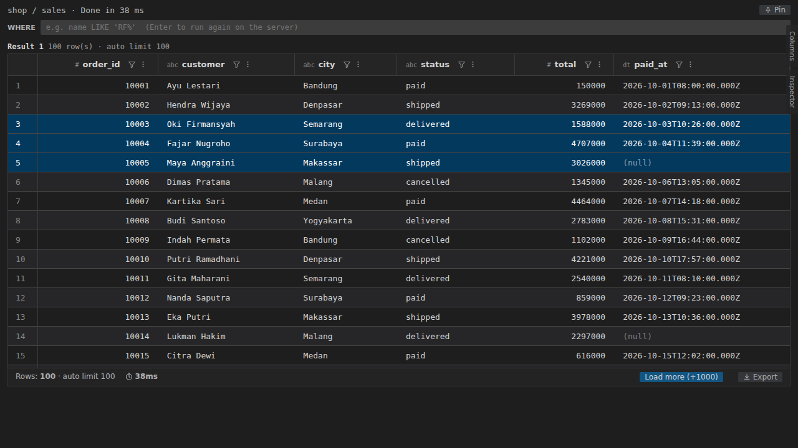
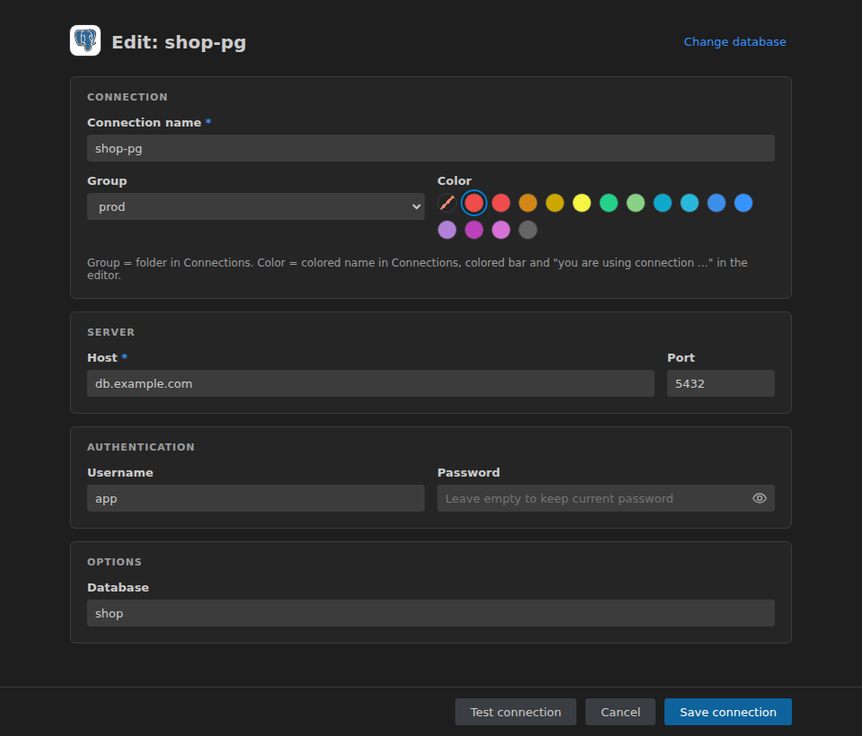
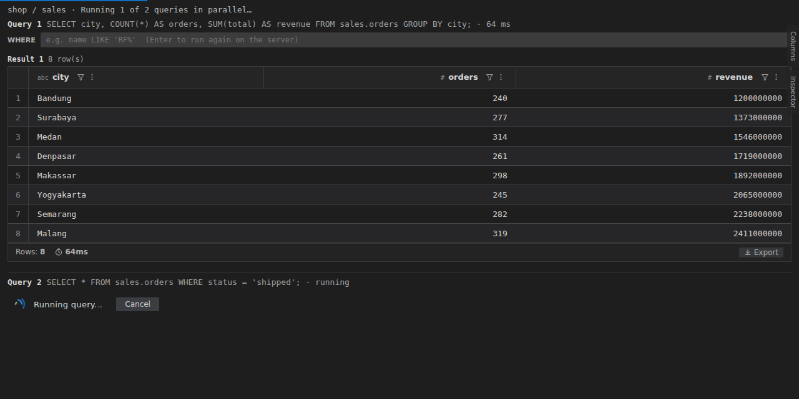
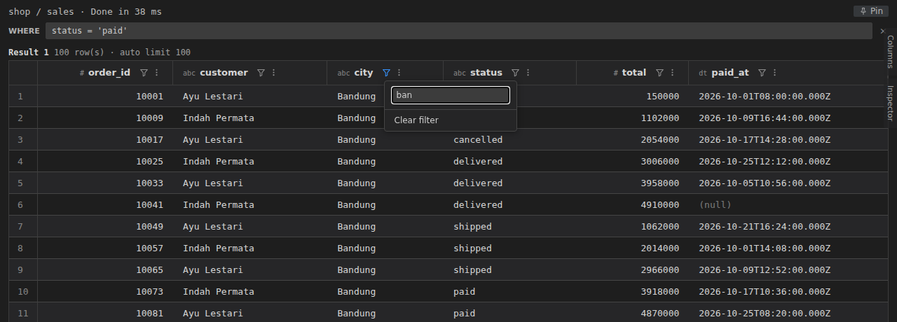
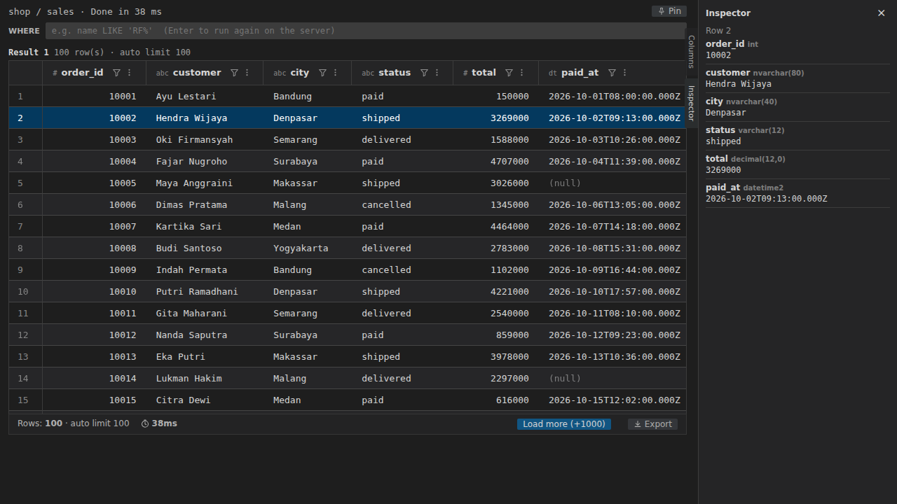
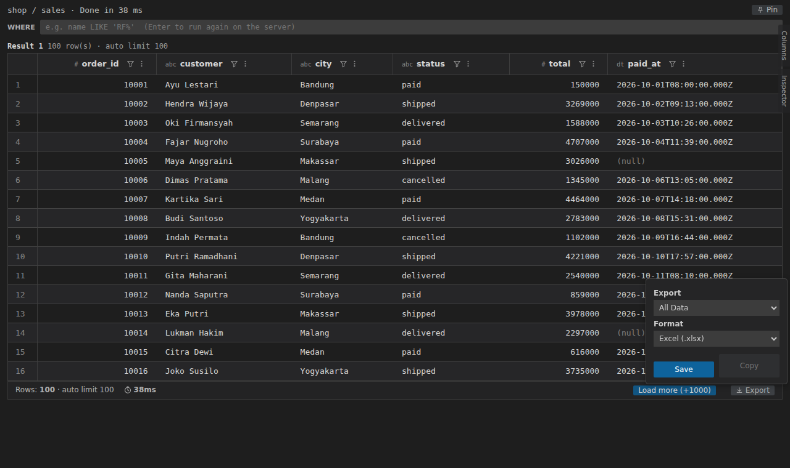
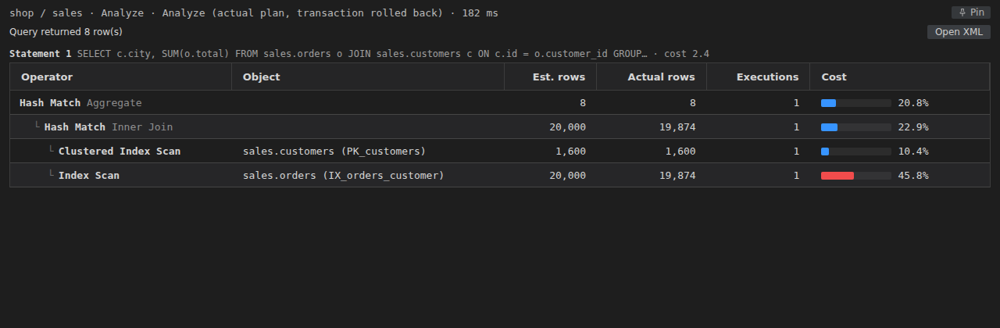

# Moonage Daydream

[English](README.md) | Bahasa Indonesia

Database client untuk VS Code: SQL Server, MySQL / MariaDB, PostgreSQL, SQLite dan MongoDB. Tulis query di file `.sql`, jalankan dengan shortcut atau CodeLens, lalu lihat, filter, edit dan export hasilnya di grid.



## Fitur

- **Lima jenis database**:
  - **SQL Server**: SQL login atau Windows authentication (NTLM dengan domain), named instance lewat SQL Server Browser, opsi *trust server certificate*, pemisah batch `GO`.
  - **MySQL / MariaDB** (mysql2) dan **PostgreSQL** (pg).
  - **SQLite** (sql.js, WebAssembly): file database dibaca setiap query dan ditulis balik setelah statement yang mengubah data.
  - **MongoDB**: query gaya mongosh seperti `db.users.find({ age: { $gt: 30 } }).sort({ name: 1 }).limit(10);`, plus `aggregate`, `countDocuments`, `distinct`, insert / update / delete, `db.getCollection(...)` dan `db.runCommand(...)`. Dokumen ditampilkan sebagai kolom grid. Host boleh berupa connection string `mongodb://` atau `mongodb+srv://`.
- **View Connections**: koneksi → database → Tables / Views / Procedures → kolom, dengan logo per jenis database. **Select Top 100** pada table atau view, **New SQL File** pada database. Password disimpan di SecretStorage VS Code.
- **Group dan warna koneksi**: kelompokkan koneksi ke folder group (mis. `prod`, `non-prod`) dan beri warna; koneksi berwarna juga ditandai di editor `.sql`, membantu mengenali koneksi production.
- **Koneksi dan database per file**, tampil dan bisa diganti lewat CodeLens di atas file.
- **Run**: selection, atau statement di posisi kursor. CodeLens per statement: **Execute**, **Explain**, **Analyze** (hanya SELECT). Beberapa SELECT yang dipilih bersamaan berjalan paralel. Query yang sedang berjalan bisa di-cancel di server.
- **Auto limit** untuk satu SELECT, lalu **Load more (+1000)** sampai 50.000 baris di grid.
- **Mode transaksi manual** per file dengan lens **Commit** / **Rollback**.
- **Grid hasil**: tag tipe kolom, toolbar WHERE yang menjalankan ulang query di server, filter / sort / hide per kolom pada baris yang sudah dimuat, urutan kolom bisa diubah, panel samping **Columns** / **Inspector**, pilih baris lalu Ctrl+C (tersalin sebagai TSV), virtual scroll untuk hasil besar.
- **Export** semua data atau baris terpilih ke CSV, TSV, JSON, JSON (pretty), Markdown, HTML atau Excel (.xlsx), atau salin ke clipboard.
- **Pin results** supaya hasil tetap di tab sendiri, berdampingan.
- **Edit cell**: perubahan menghasilkan script UPDATE berdasarkan primary key di tab baru. Script tidak pernah dijalankan otomatis.
- **Execution plan**: plan grafis dengan bar cost untuk SQL Server; output `EXPLAIN` sebagai grid untuk database lain.
- **Dukungan editor**: autocomplete (database, schema, table, kolom termasuk alias, keyword dan function; untuk MongoDB collection, method, nama field dan operator `$`), formatter (dialect mengikuti koneksi), lint untuk statement tanpa `;` dengan Quick Fix.
- **View samping**: **SQL Files** (folder atau daftar rata, dengan rename, duplicate, delete dan drag & drop), **Running Queries**, **Query History**.

## Instalasi

Dari source:

```bash
npm install
npm run install:local   # build VSIX lalu install bila versinya berubah (tambah -- --force untuk install ulang)
```

Lalu jalankan **Developer: Reload Window**.

Atau build paketnya dan install manual:

```bash
npm run package
code --install-extension moonage-daydream-<version>.vsix
```

## Cara pakai

### 1. Tambah koneksi

Buka view **Moonage Daydream** di Activity Bar lalu klik **+** (**Add Connection**) di view **Connections**. Pilih **Database type**, lalu isi nama, host, port, username, password dan (opsional) database default. **Test** mengecek koneksi sebelum disimpan.



Untuk SQL Server form juga punya Windows authentication (domain), instance name dan *trust server certificate*. Untuk MongoDB host boleh berupa connection string lengkap `mongodb://` atau `mongodb+srv://`. Untuk SQLite, isi path file database.

**Group** menaruh koneksi di sebuah folder di **Connections**: pilih *No group*, group yang sudah ada, atau *New group…* untuk mengetik nama baru. Setiap folder group menampilkan jumlah koneksi di dalamnya; **+** (**Add Connection**) pada folder group langsung memilih group itu. Klik kanan koneksi untuk **Move to Group…**, atau folder group untuk **Rename Group…**. Di quick pick koneksi, group ditampilkan sebagai `[group]`.

**Color** (None, Red, Orange, Yellow, Green, Blue, Purple; warna chart dari tema VS Code) menandai koneksi:

- di **Connections** nama koneksi tampil dengan warna itu dan badge ●;
- di editor `.sql` yang terikat ke koneksi itu, ada bar berwarna di kiri semua baris, dan label `you are using connection <group> - <nama>` (tanpa group: `you are using connection <nama>`) tampil di akhir baris teratas yang terlihat, jadi tetap terlihat saat scroll.

Pakai misalnya Red untuk koneksi production.

Expand koneksi untuk melihat database, table, view, procedure dan kolom. Pakai ikon play pada table atau view untuk **Select Top 100**, atau ikon file baru pada database untuk **New SQL File** yang langsung terikat ke database itu.

### 2. Menjalankan query

Buka atau buat file `.sql`. CodeLens di atas file menampilkan koneksi dan database file itu; klik untuk mengganti. Lalu:

- **Ctrl+Alt+Enter** menjalankan selection, atau statement di posisi kursor. **Ctrl+Enter** melakukan hal yang sama bila extension DBCode tidak terpasang.
- Setiap statement punya lens **Execute**, **Explain** dan (untuk SELECT) **Analyze**.
- Saat query berjalan, muncul lens **Cancel**; query di-cancel di server.

```sql
SELECT order_id, customer, city, status, total
FROM sales.orders
WHERE status = 'paid';
```

Satu SELECT tanpa limit sendiri hanya mengambil `moonageDaydream.query.autoLimit` baris pertama (default 100). **Load more (+1000)** mengambil halaman berikutnya, sampai 50.000 baris di grid.

Pilih beberapa statement SELECT lalu jalankan bersamaan: semuanya berjalan paralel dan tiap hasil muncul begitu selesai.



### 3. Filter dan sort

Ketik kondisi di kotak **WHERE** lalu tekan Enter: query dijalankan ulang di server dengan kondisi itu. Ikon filter di header kolom memfilter baris yang sudah dimuat berdasarkan teks; menu kolom untuk sort atau hide kolom. Urutan kolom dan tampil / sembunyi kolom diatur dengan drag dan centang di panel samping **Columns**.



Klik baris untuk memilihnya (Ctrl / Shift untuk lebih dari satu baris); Ctrl+C menyalin pilihan sebagai TSV. Panel samping **Inspector** menampilkan semua kolom dari baris terpilih beserta tipenya; **Columns** menampilkan daftar kolom beserta tipenya.



### 4. Export

Klik **Export**, pilih **All Data** atau selection dan format (Excel .xlsx, CSV, TSV, JSON, JSON pretty, Markdown, HTML), lalu **Save** ke file atau **Copy** ke clipboard.



**Pin** menyimpan hasil saat ini di tab sendiri supaya tidak tertimpa query berikutnya.

### 5. Edit cell

Double-click cell di hasil pertama untuk mengeditnya. Jumlah cell yang diubah tampil di footer; **Generate UPDATE script** membuka script UPDATE berdasarkan primary key di tab baru, **Discard** membuang perubahan. Periksa script-nya lalu jalankan sendiri; script tidak pernah dijalankan otomatis.

### 6. Explain dan Analyze

**Explain** menampilkan estimated plan tanpa menjalankan statement. **Analyze** menjalankan SELECT dan menampilkan actual plan (di SQL Server di dalam transaksi yang di-rollback). Untuk SQL Server plan tampil sebagai tree operator dengan bar cost (**Open XML** membuka plan mentahnya); untuk database lain output `EXPLAIN` tampil sebagai grid.



### 7. Transaksi

Default-nya setiap statement auto-commit. Ganti file ke mode manual dengan **Toggle Transaction Mode** (atau CodeLens / status bar): statement lalu berjalan di transaksi yang terbuka sampai Anda klik **Commit** atau **Rollback**. Default untuk file baru diatur lewat `moonageDaydream.transaction.mode`.

### 8. Autocomplete, formatter dan lint

**Format SQL** (Ctrl+Alt+F, atau Format Document) memakai dialect SQL dari koneksi file tersebut. Huruf keyword, koma di depan dan titik koma di baris sendiri bisa diatur. Statement tanpa `;` penutup ditandai, dengan Quick Fix untuk menambahkannya.

Untuk koneksi MongoDB autocomplete mengikuti sintaks shell:

- setelah `db.`: nama collection dan method db (`getCollection`, `runCommand`, `stats`, …);
- di dalam `db.getCollection("`: nama collection;
- setelah `db.orders.` atau `db.getCollection("orders").`: method collection (`find`, `findOne`, `aggregate`, `countDocuments`, `updateOne`, `deleteMany`, …), disisipkan sebagai snippet;
- setelah `).`: method cursor (`sort`, `limit`, `skip`, `project`, `hint`, `explain`, …);
- di dalam `{ }` sebuah `find`, `sort` dan sejenisnya: nama field (diambil dari satu dokumen collection itu) dan operator `$`.

### 9. View

- **SQL Files**: semua file `.sql` di workspace, sebagai folder (default) atau daftar rata; pilihannya diingat. **New SQL File** pada folder. Klik kanan file atau folder untuk **Rename…** (F2), **Duplicate…**, **Delete** (tombol Delete), **Copy Path**, **Copy Relative Path**, **Open to the Side** dan **Reveal in Explorer View**. **Delete** memindahkan item ke Recycle Bin / Trash; di jendela remote (WSL, SSH) tidak ada Trash, jadi diminta konfirmasi untuk hapus permanen. Drag file atau folder ke sebuah folder untuk memindahkannya; drag file ke editor untuk membukanya (drop di tepi editor untuk membukanya di split). Koneksi dan database yang terikat ke file ikut pindah saat rename atau move, dan ikut disalin oleh **Duplicate**.
- **Running Queries**: query yang sedang berjalan beserta lama berjalannya, cancel satu atau semua.
- **Query History**: jalankan lagi, salin SQL, buka di editor, hapus, kosongkan.

**Move Results To…** (judul view Results) memindahkan hasil ke panel bawah, atau ke kanan atau kiri editor.

Error ditulis ke output channel **Moonage Daydream** (**View → Output**).

## Settings

| Setting | Default | Keterangan |
| --- | --- | --- |
| `moonageDaydream.query.autoLimit` | `100` | Auto limit untuk satu SELECT tanpa TOP / OFFSET FETCH / INTO. `0` = mati |
| `moonageDaydream.transaction.mode` | `auto` | Mode transaksi default untuk file SQL: `auto` atau `manual` |
| `moonageDaydream.format.keywordCase` | `upper` | Huruf keyword saat format: `upper`, `lower`, `preserve` |
| `moonageDaydream.format.leadingComma` | `true` | Koma di awal baris (`    , column`) |
| `moonageDaydream.format.semicolonNewline` | `true` | Titik koma penutup statement di baris sendiri |
| `moonageDaydream.lint.semicolon` | `error` | Tandai statement tanpa `;`: `error`, `warning`, `off` |

Extension ini juga menjadikan dirinya formatter default untuk `[sql]`.

## Keybinding

| Tombol | Command |
| --- | --- |
| Ctrl+Alt+Enter (Cmd+Alt+Enter) | Run Query (selection atau statement di posisi kursor) |
| Ctrl+Enter (Cmd+Enter) | Run Query, hanya bila extension DBCode tidak terpasang |
| Ctrl+Alt+F (Cmd+Alt+F) | Format SQL |
| Shift+Alt+F | Format SQL, bila Moonage Daydream adalah formatter SQL |
| F2 (Enter) | Rename… di view SQL Files |
| Delete (Cmd+Backspace) | Delete di view SQL Files |

## Command

| Command | Keterangan |
| --- | --- |
| `Moonage Daydream: Add Connection` / `Edit Connection` / `Remove Connection` | Kelola koneksi |
| `Moonage Daydream: Select Connection` | Pilih koneksi aktif |
| `Moonage Daydream: Move to Group…` / `Rename Group…` | Group koneksi (view Connections) |
| `Moonage Daydream: Change Connection for This File` / `Change Database for This File` | Koneksi dan database per file |
| `Moonage Daydream: Run Query (selection or statement at cursor)` | Jalankan selection atau statement di posisi kursor |
| `Moonage Daydream: Explain (estimated plan)` / `Analyze (actual plan, SELECT only)` | Execution plan |
| `Moonage Daydream: Cancel Query` / `Cancel All Running Queries` | Cancel di server |
| `Moonage Daydream: Toggle Transaction Mode (Auto-commit / Manual)` | Ganti mode transaksi file |
| `Moonage Daydream: Commit Transaction` / `Rollback Transaction` | Akhiri transaksi manual |
| `Moonage Daydream: Pin Results (keep in its own tab, side by side)` | Pin hasil saat ini |
| `Moonage Daydream: Move Results To…` | Panel, kanan atau kiri editor |
| `Moonage Daydream: Format SQL (Moonage)` | Format dokumen atau selection |
| `Moonage Daydream: New SQL File` | Buat file `.sql` |
| `Moonage Daydream: Rename…` / `Duplicate…` / `Delete` | Kelola file atau folder (view SQL Files) |
| `Moonage Daydream: Copy Path` / `Copy Relative Path` / `Open to the Side` / `Reveal in Explorer View` | View SQL Files |
| `Moonage Daydream: Show SQL Files as List` / `Show SQL Files as Folders` | Tampilan view SQL Files |
| `Moonage Daydream: Clear History` | Kosongkan query history |

## Batasan

- SQLite: seluruh file database dibaca setiap query, dan query yang sedang berjalan tidak bisa di-cancel.
- MongoDB: tidak ada transaksi manual dan tidak ada formatter.
- Grid menampung maksimal 50.000 baris (Load more berhenti di situ); pakai Export untuk semua data.
- SQLite tidak punya Analyze (hanya `EXPLAIN QUERY PLAN`).

## Development

```bash
npm install
npm run compile          # TypeScript -> out/
npm test                 # compile + unit test (node --test)
npm run test:servers     # integration test ke MySQL 8.4, MariaDB 11.4, PostgreSQL 16, MongoDB 7 di Docker
npm run test:servers-ui  # container Docker yang sama, ditest di Extension Development Host
npm run test:real        # Extension Development Host ke koneksi SQL Server yang sudah ada (hanya SELECT)
npm run package          # build .vsix (vsce)
npm run install:local    # build + install ke VS Code lokal (tambah -- --force untuk install ulang versi yang sama)
node scripts/screenshots.js   # buat ulang gambar README (setelah npm run compile)
```

`npm run test:servers` butuh Docker. Script ini menjalankan container, menjalankan `src/test/servers.itest.ts`, lalu menghapus container dan image; set `KEEP_IMAGES=1` untuk menyimpan image untuk run berikutnya.

`npm run test:servers-ui` menjalankan container Docker yang sama (MySQL, MariaDB, PostgreSQL, MongoDB) lalu menjalankan test di Extension Development Host (`scripts/real-test.sh servers`, `serversUiTest` di `src/test/real/index.ts`). Test ini menambahkan koneksi sementara bernama `__moonage_it_*` ke profil VS Code (plus file SQLite sementara), mencoba run / CodeLens / Load more / export / script UPDATE / Explain / transaksi manual / explorer / completion / format, lalu menghapus koneksi sementara beserta password-nya dan mengembalikan daftar koneksi persis seperti semula (backup daftar, tanpa password, ditulis ke `docs/main/backup/`). Container dan image dihapus setelah selesai kecuali `KEEP_IMAGES=1`.

`npm run test:real` dan `npm run test:servers-ui` membuka Extension Development Host lalu memulai test dengan menulis file pemicu (`docs/main/temp/real-test.trigger`) yang dipantau jendela development. Hanya bila belum ada laporan setelah sekitar 30 detik, URI `vscode://` dibuka lewat `powershell.exe` sebagai cadangan, jadi tetap bisa dijalankan dari WSL dengan VS Code di Windows.

`scripts/real-test.sh <nama>` menjalankan satu kelompok test: `files` (view SQL Files), `groups` (group koneksi), `servers` (test `test:servers-ui`, butuh container-nya) atau `big` (hasil besar dan cancel); tanpa nama, seluruh suite `test:real` dijalankan.

## Lisensi

MIT, lihat [LICENSE](LICENSE).

### Kredit

Logo database di view Connections (`media/db/*.svg`) berasal dari [devicon](https://github.com/devicons/devicon) 2.18.0 (MIT License). Logo-logo tersebut adalah merek dagang pemiliknya dan hanya dipakai untuk menandai jenis database sebuah koneksi; lihat [media/db/NOTICE.md](media/db/NOTICE.md).
